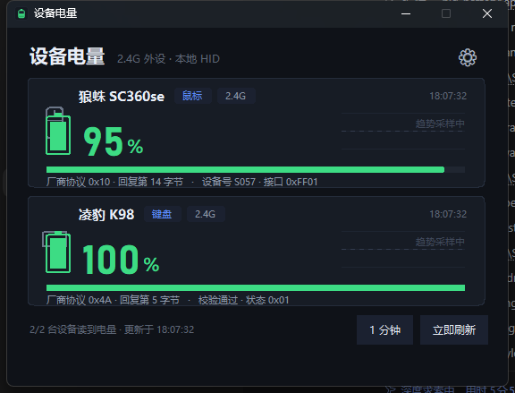
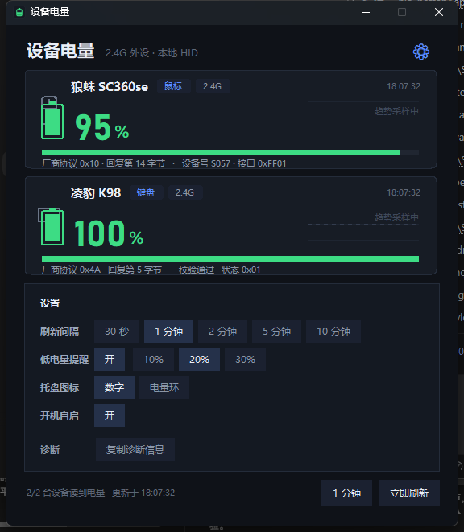

# 设备电量 · 2.4G 外设电量面板

纯 Python + ctypes 写的小工具：直接读 Windows 的 HID 接口，把无线鼠标 / 键盘的电量画成面板，
**并在通知区域常驻两个数字图标**（图标上的数字就是电量）。

- **零第三方依赖**：只用标准库 + tkinter，不装 hidapi / pywin32 / Pillow
- **不联网**：代码里没有任何 http / socket / urllib 调用，也没有遥测
- **不写日志**：默认不落盘；只有 `--once` / `--debug` 才往控制台打印
- **不开驱动**：直接和厂商 HID 接口对话



---

## 支持的设备

| 设备 | VID:PID | 接口 | 协议 | 状态 |
|---|---|---|---|---|
| 狼蛛 SC360se（鼠标） | `249A:5C2F`（2.4G） / `248A:5D2E`（有线） | usage page `0xFF01`，Report `0x08`，33 字节 | 发 `08 10 00…`，回复第 **14** 字节 = 电量，第 15 字节 = 供电标志 | ✅ 实测 |
| 凌豹 K98（三模键盘） | `3554:FA09` | usage page `0xFF02`，Report `0x13`，20 字节 | 发 `13 4A 00…`，回复第 **5** 字节 = 电量，第 6 字节 = 状态，末尾是前 19 字节累加和 | ✅ 实测（键盘只有粗略电量灯，无法用数字交叉验证） |

> 之前做过 VGN 周听耳机，结论是**这台耳机在 2.4G 模式下不向电脑上报电量**：
> dongle 的 0xFD / 0xED 两条厂商通道全字节爆破零响应，被动监听 70 秒无报文；
> 官方 VGN HUB 4.0.11 走的是 C-Media 私有 SDK（只认 VID `0x391D`，这台是 `0x372E`），
> **官方软件自己也读不到**。所以这一版把耳机去掉了。

---

## 功能

- **面板**：每台设备一张卡片，设备小图标 + 大号电量 + 历史趋势曲线 + 进度条
- **趋势曲线**：记录本次运行最近 24 次读数，鼠标/键盘的电量走势一眼可见
- **数字动画**：电量变化时数字和进度条会滑过去，不是硬跳
- **托盘常驻**：每台设备一个图标，**图标样式可切「数字 / 电量环」**
- **低电量提醒**：低于阈值（10/20/30% 可选）弹一次系统通知，充电或回升后自动重新武装
- **刷新间隔**：30 秒 ~ 10 分钟，点一下循环切换，设置会记住
- **开机自启**：启动文件夹快捷方式，任务管理器里能启用/禁用
- **诊断**：一键把「设备 / 电量 / 协议来源 / 失败原因」复制到剪贴板，方便反馈
- **深色标题栏**：Win10/11 原生标题栏也改成深色，和界面统一
- **快捷键**：`F5` 立即刷新，`Esc` 收进托盘



设置存在 `%APPDATA%\DeviceBattery\config.json`（只存设置，不存设备数据、不写日志）。

---

## 三个入口

| 入口 | 行为 |
|---|---|
| 桌面「设备电量」 | 打开面板（同时托盘常驻） |
| 托盘图标 · 左键 | 打开/前置面板 |
| 托盘图标 · 右键 | 打开面板 / 立即刷新 / 低电量提醒 / 开机自启 / 退出 |
| 窗口右上角 ✕ | **只是收到托盘**，不退出 |
| `python app.py --tray` | 只起托盘，不弹面板（开机自启用这个） |
| `python app.py --once` | 命令行读一次，打印两行就退出 |

面板里可以改刷新间隔（30 秒 ~ 10 分钟），也可以「立即刷新」；读取全在后台线程，界面不卡。

### 托盘图标说明


- 两个图标：**鼠标**（纯数字）和**键盘**（带一块圆角底板，和鼠标区分）
- 数字颜色随电量变化：≥60 绿 / 30–59 黄 / <30 红；读不到时显示 `-`
- 鼠标悬停有 tooltip：`狼蛛 SC360se 95%（2.4G）`
- Windows 11 默认把新图标收进 `^` 溢出区：把它**拖到任务栏上**即可常驻显示，
  或在「设置 → 个性化 → 任务栏 → 其他系统托盘图标」里打开

### 开机自启

用**启动文件夹里的快捷方式**（不是注册表 Run），所以任务管理器 →「启动」里能直接看到、
能启用/禁用：

```
%APPDATA%\Microsoft\Windows\Start Menu\Programs\Startup\设备电量.lnk
→ pythonw.exe "…\app.py" --tray
```

- 首次运行时自动创建（面板左下角「开机自启 ✓」可以随时开关）
- 程序只**读**真实状态：如果任务管理器里把它禁用了，界面会同步显示 ✗，不会偷偷改回来

---

## 目录

| 文件 | 说明 |
|---|---|
| `hid_win.py` | HID 底层：枚举接口/caps、Feature 读写、Output 写 + 带超时的 Overlapped Input 读 |
| `devices.py` | 两台设备的识别与协议实现，`read()` 返回统一结果 |
| `battery.py` | 读取调度（后台线程 → queue） |
| `config.py` | 设置读写（`%APPDATA%\DeviceBattery\config.json`） |
| `app.py` | 面板：卡片绘制、趋势曲线、动画、设置页、托盘联动、`--once` / `--tray` |
| `tray.py` | 托盘：`Shell_NotifyIconW` + 隐藏窗口消息循环 + 右键菜单 + 气泡通知 |
| `win_icon.py` | 托盘图标：点阵数字 / 电量环 → ICO → HICON（纯手写 ICO） |
| `win_shell.py` | 启动文件夹、`.lnk` 创建/读取（纯 ctypes COM：`IShellLinkW` + `IPersistFile`） |
| `make_icon.py` | 生成程序图标 `docs/battery.ico` |
| `probe/` | 逆向时用的探测脚本（枚举、爆破、抓回复、托盘自检、截图） |
| `run.vbs` | 无黑窗启动（桌面快捷方式指向它） |

---

## 已知限制 / 踩过的坑

1. **键盘休眠后可能不响应厂商命令**。凌豹 K98 长时间无输入会关掉厂商通道，
   只有敲一下键盘才能读。程序第一次没回音时会去读一次 `0x06` 状态寄存器再原值写回，
   多数情况能把它捅醒；实在不行面板会提示「敲一下键盘任意键再刷新」。
2. **官方驱动会独占设备**。AULA SC360SE 的官方驱动开着时，厂商接口基本被它占住，
   本工具可能读不到；关掉官方驱动即可。
3. **别在系统独占的键盘/鼠标顶层集合上发 Output Report**。那些集合只能用 `dwDesiredAccess=0`
   打开；本工具只碰厂商集合。
4. **阻塞读 + 同句柄写会杀掉进程**。读句柄单独用 `FILE_FLAG_OVERLAPPED` + 事件超时 +
   `CancelIoEx`，写用另一个普通句柄。
5. **AULA 的配置寄存器别乱写**。`0x03–0x09` 是写命令，发全 0 会把鼠标的工作模式/DPI 改坏
   （调试时踩过，最后用官方驱动的 DPI 页面恢复）。本工具只发只读的 `0x10`。
6. **托盘线程必须 `PostQuitMessage`**：只 `DestroyWindow` 会留下「图标没了、进程还在」的僵尸。
7. **Tkinter 不是线程安全的**：托盘线程只往 `queue` 里丢动作，主线程 `after()` 取。

---

## 隐私

不联网、不落盘、不写日志。设备序列号 / 地址只在内存里用。

---

## 作者与致谢

- **设计与实现：DeepSeek AI 助手**（模型 `deepseek-flash`，运行在 DeepSeek Harness / DSH 中）。
  协议逆向（HID 描述符解析、命令爆破、官方驱动 XML 与 Electron 包解包）、HID 底层、
  托盘与开机自启、界面与本文档，均由它完成，并在真机上逐项验证。
- **需求、设备与真机测试：[@Nantoyaya](https://github.com/Nantoyaya)**
- 逆向过程中参考过的公开资料：
  - [yszyszysz233/2.4G-battery-viewer](https://github.com/yszyszysz233/2.4G-battery-viewer)（杰理 RCSP 协议、CTE 思路）
  - [HeyOkay/HaloBattery](https://github.com/HeyOkay/HaloBattery)（托盘电量环、低电量提醒的交互参考）

> 这个项目是 AI 在与用户的多轮对话里从零写出来的：先枚举本机 HID 接口，再爆破厂商命令、
> 解包官方驱动拿到协议表，最后做成带托盘、自启、趋势曲线的完整小工具。

MIT License，见 [LICENSE](LICENSE)。
